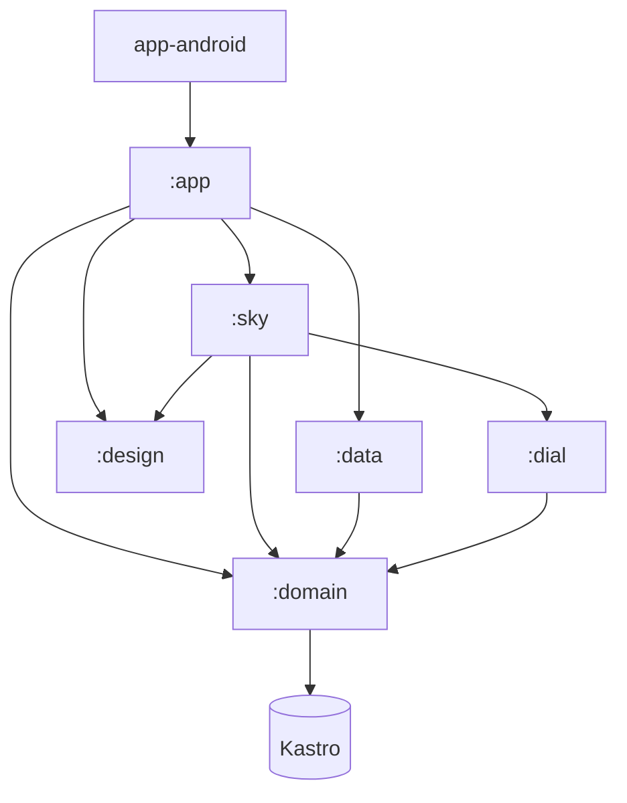
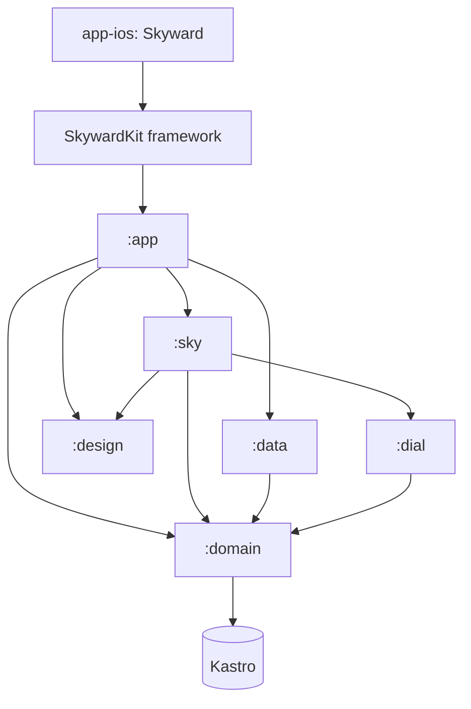
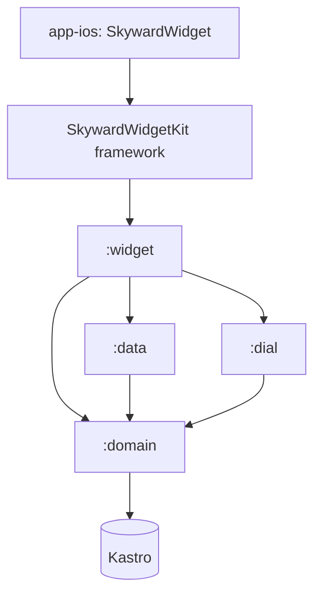

# Architecture

Skyward is a Kotlin Multiplatform project. Kastro computes the sky; Kotlin turns a day into a
renderer-agnostic dial model; Compose Multiplatform draws it in the app on both platforms, and a
SwiftUI `Canvas` draws the same model in the iPhone widget.

## Modules

It is a one-screen app, so the screen's UI lives in a single feature module, `:sky`.

| Module | Kind | Purpose |
|---|---|---|
| `:domain` | KMP (jvm, android, ios) | Sky and location models and repository contracts. Exposes Kastro, kotlinx-datetime and coroutines. |
| `:data` | KMP (jvm, android, ios) | Kastro-backed sky repository, platform location sources, last-location store. |
| `:dial` | KMP (jvm, android, ios), no Compose | Dial model builder (angles, radii, colors, markers, labels, hand, moon phase) and hit-testing. |
| `:design` | KMP Compose (android, ios) | Theme, colors and typography. |
| `:sky` | KMP Compose (android, ios) | The screen: ViewModel, dial renderer, detail card and tabs. |
| `:app` | KMP Compose (android, ios) | Root composable (theme) and Koin DI assembly. Builds the iOS framework `SkywardKit`. |
| `:widget` | KMP (jvm, ios), no Compose | Swift-facing dial timeline for the widget. Builds the static iOS framework `SkywardWidgetKit`, exporting `:dial` and `:domain`. |
| `app-android` | Android app | Thin Android entry point. |
| `app-ios` | XcodeGen project | iPhone app (hosts `SkywardKit`) and the `SkywardWidget` extension (links `SkywardWidgetKit`). |

The app and the widget run in separate processes with separate Kotlin frameworks, which keeps
Compose out of the widget extension's memory.

## Android app

## iPhone app

## iPhone widget

## Project config

- Dependency and plugin versions: `gradle/libs.versions.toml`.
- JDK target, Android SDK levels and the Android application ID: `gradle.properties`. The Gradle daemon itself is pinned to JDK 17 in `gradle/gradle-daemon-jvm.properties`.
- iOS bundle IDs, App Group and deployment target: `app-ios/project.yml`.
