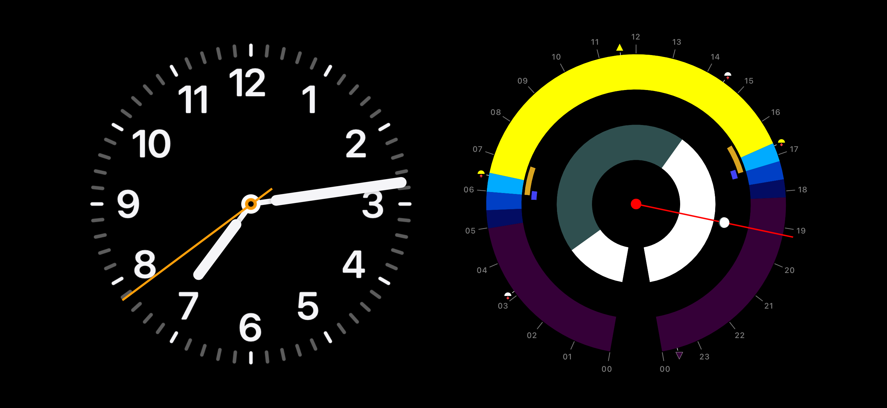
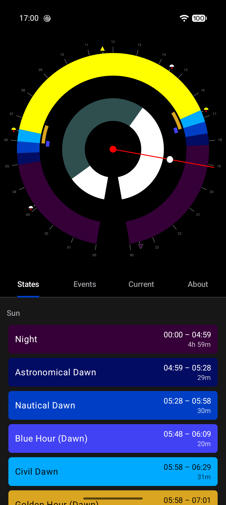

# Skyward

A 24-hour sun and moon dial for Android and iPhone, with an iPhone StandBy widget that shows just
the dial on your nightstand.

The dial shows today, midnight to midnight, at your approximate location: the solar phases
(night, astronomical, nautical and civil twilight, day), golden and blue hour, when the moon is
up, the day's sun and moon events, and a hand for the current time with the moon's phase. Below
it, tabs list today's states and events and the sun and moon right now.

<p>
  
</p>

<p>
  
</p>

## Credits

- Sun and moon calculations by [Kastro](https://github.com/yoxjames/Kastro) (Apache-2.0), by
  James Yox.
- The dial, the phase derivations and the descriptions of each phase and event are ported from
  [kastro-demo](https://github.com/yoxjames/kastro-demo) (GPL-3.0), by James Yox. Its golden
  hour and blue hour descriptions draw on
  [timeanddate.com](https://www.timeanddate.com/astronomy/golden-hour.html).

## Building

Requirements:

- JDK 17. The Gradle daemon is pinned to exactly 17 in `gradle/gradle-daemon-jvm.properties`,
  because detekt 1.23.8 does not run on newer JDKs.
- The Android SDK.
- Xcode with the iOS 17+ SDK, and [XcodeGen](https://github.com/yonaskolb/XcodeGen).

Android:

```sh
./gradlew :app-android:assembleDebug     # or :app-android:installDebug with a device attached
```

iPhone app and widget:

```sh
cd app-ios
xcodegen
open Skyward.xcodeproj                   # signing is preconfigured; see app-ios/README.md
```

or from the command line:

```sh
xcodebuild -scheme Skyward -destination 'generic/platform=iOS Simulator' build
```

Tests and checks:

```sh
./gradlew :data:jvmTest                  # each non-UI module tests on the JVM
./gradlew ktfmtCheck detekt
```

Dependency versions live in `gradle/libs.versions.toml`; `scripts/latest-versions.sh` prints the
latest stable version of each from Maven Central, Google Maven and the Gradle Plugin Portal.

See [ARCHITECTURE.md](ARCHITECTURE.md) for the module layout and [app-ios/README.md](app-ios/README.md)
for the iOS project, bundle IDs and signing. [RELEASES.md](RELEASES.md) covers making a release.

## License

Skyward is free software under the [GNU General Public License v3.0](LICENSE).
